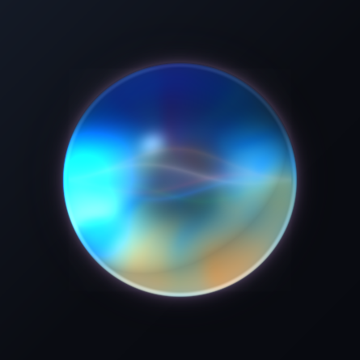

<div align="center">

# dsh-liquid-glass-siri

**给 DeepSeek Harness 的苹果「液态玻璃」Siri 水晶球前端 —— 一个 DSH 插件**

An Apple-style *Liquid Glass* Siri orb frontend for DeepSeek Harness, shipped as a single DSH client plugin.



</div>

---

## 这是什么

一个 **DSH 客户端插件（client plugin）**。装上之后，DSH 的网页端右下角会多出一颗液态玻璃小球；
点开（或按 `Alt+S`）会把整个 DSH 界面接管成一块全屏语音面板：

- 中间是一颗 **WebGL 液态玻璃水晶球**：透镜折射、色散、上半黑镜、赤道亮线、菲涅尔玻璃壳、底部焦散；
- 说话时球内浮现 **Siri 声波**（光谱色散 + Lorentzian 发光线），音量实时驱动球体呼吸与屏幕边缘辉光；
- 识别完成后球内的光效切换成 **Siri 流体圆点**（metaball + smooth-min），回答以逐字流式显示在球下方的玻璃字幕里；
- 回答可以用浏览器语音合成朗读出来，形成「说话 → 回答 → 再听」的闭环。

后端**完全复用当前 DSH**，没有另起一套服务：

| 环节 | 复用的 DSH 能力 |
|---|---|
| 语音识别 | `@deepseek-ai/dsh-experimental-voice-input-bundle` 提供的 `ctx.remote.speech.transcribe` Remote（本机 SenseVoice） |
| 发送消息 | `ctx.get("sessions")` → `retain(sessionId)` → `session.prompt([{type:"text"}], "queue")` |
| 会话选择 | `ctx.get("uiSession").adapter.current` 当前正在看的会话 |
| 流式回答 | 该会话的 `eventSource`（`assistant/live-chunk` 与 `assistant/message` 事件） |
| 语音合成 | 浏览器自带 `speechSynthesis`（DSH 目前没有 TTS 插件） |

插件本身**零依赖、零构建**：`lib/client.js` 是手写的 classic script，安装即用。

## 安装

```bash
# 1) 把本包接入 web profile（pnpm 会自动把它加进 dsh.profile.bundles）
dsh plugin --profile web add link:/绝对路径/oppo-watch-ai/dsh-liquid-glass-siri

# 2) 完成。profile 配置有 HMR：DSH 服务端会立刻挂载插件行，
#    浏览器里刷新一次页面即可看到右下角的水晶球。
```

卸载：

```bash
dsh plugin --profile web remove dsh-liquid-glass-siri
```

> 也可以不走 bundle：直接在自己的 `~/.dsh/profiles/web/cordis.patch.yml` 里插入一行
> `- insert: [{ id: liquid-glass-siri, name: dsh-liquid-glass-siri }]`，
> 前提是该包已经能被 profile 解析到。

## 使用

| 操作 | 效果 |
|---|---|
| 点右下角水晶球 / `Alt+S` | 打开 / 关闭全屏面板 |
| 面板打开后自动聆听 | 说完点一下球（或等 60 秒自动停止）结束录音 |
| 点 `⌨` | 改用键盘输入（同样走 DSH 会话，不需要麦克风） |
| 点 `🔊` | 开 / 关语音朗读 |
| `Esc` | 正在聆听/思考时先取消，空闲时关闭面板 |
| 点 `✕` / 点空白处 | 关闭面板 |

首次使用需要在浏览器里允许**麦克风权限**（`http://127.0.0.1` 属于安全上下文，可以正常弹权限）。

## 配置

所有参数都可以在 profile 里按行 id 覆盖：

```yaml
# ~/.dsh/profiles/web/cordis.patch.yml
- id: liquid-glass-siri
  config:
    language: zh          # 传给语音识别插件的语言提示
    autoListen: true      # 打开面板即开始聆听
    continuous: false     # 回答结束后自动再次聆听（免提对话）
    speakReplies: true    # 用浏览器语音合成朗读回答
    hotkey: KeyS          # Alt+S / Ctrl+Shift+S / Cmd+Shift+S
    launcher: true        # 显示右下角悬浮球
    # ── 球体外观 ──
    scale: 0.62           # 球半径（占视口短边的一半）
    refraction: 0.42      # 边缘折射强度
    band: 0.62            # 折射作用带宽
    dome: 0.40            # 内部放大
    aberration: 0.055     # 色散强度
    topDarken: 0.84       # 上半黑镜浓度
    black0: -0.15         # 黑镜窗口下沿（球坐标 y）
    black1: 0.75          # 黑镜窗口上沿
    edgeBleed: 0.18       # 赤道亮线 / 底部焦散增益
    brightness: 1.06
    fx: 1.0               # 球内光效强度
    renderScale: 0.72     # 内部渲染倍率（越低越省电）
```

## 本地调试

```bash
node tools/preview-server.mjs 8899
# 浏览器打开 http://127.0.0.1:8899/demo/preview.html
```

`demo/preview.html` 用一个假的 `window.__ModuleLoader__` 直接加载**真正的** `lib/client.js`，
带一排实时滑块 + 状态切换按钮，改完 `lib/client.js` 页面会自动重载；
点「示例字幕」可以预览字幕样式，按 `H` 隐藏控制面板看真实观感。

页面会把两颗 canvas 合成后的 PNG `POST` 到 `/shot?label=…`，落在 `shots/` 下 ——
这是在没有系统截图能力的环境里做像素级校验用的。

## 实现要点

**为什么是一个 vanilla client plugin。** DSH 的浏览器端插件就是
`window.__ModuleLoader__.load({ id, factory })` 注册的 classic script，`id` 必须等于包名，
factory 返回的对象就是 cordis 插件（`apply(ctx, config)`）。本插件不 `require()` 任何模块
（模块表里只有 9 个 seed word），也不注册 React slot —— 它把全屏 DOM 挂在 `document.body` 上，
用 `z-index` 盖住 DSH，因此升级 DSH 内部组件树不影响它。

**球体着色。** `lib/client.js` 里的 `ORB_FRAG` 是一个球面着色模型，不是把 2D 图案贴上去：
先由法线 `nrm` 驱动漫反射、Blinn 高光与菲涅尔，再用域扭曲 FBM + 余弦调色板生成
「玻璃内部流动的液体」，最后叠上上半黑镜、赤道亮线、底部焦散与玻璃壳细线。
颜色通道的色散用同一个扭曲场做 ±偏移，只多做两次廉价着色，不做三次噪声采样。
内部光效（声波 / 流体圆点）是独立 canvas，用 `mix-blend-mode: screen` 叠在球上并裁进圆形。

**语音链路。** 采集用 `getUserMedia` + `MediaRecorder`，`AnalyserNode` 出实时电平；
停止后 `decodeAudioData` → `OfflineAudioContext(1, n, 16000)` 重采样 → PCM16 WAV → base64，
和 DSH 语音插件发给宿主 `speech/transcribe` 的载荷完全一致，所以直接复用它的 provider。
`AudioContext` 是**共享且在手势里预热**的：Firefox/Safari 的自动播放策略会拒绝
非手势创建的上下文，而免提路径是在点击之后约 400ms 才开始采集。

**回答文本。** 从会话的 `eventSource` 里按序读取：durable 的 `assistant/message` 取最后一个，
client-only 的 `assistant/live-chunk`（`text-delta`）拼出正在流式生成的部分，
两者相加就是球体字幕上滚动的文字。

## 目录

```
dsh-liquid-glass-siri/
├── package.json          # dsh.bundle.patch + dsh.client.platform=web
├── cordis.patch.yml      # 插入 Loader 行（id: liquid-glass-siri）
├── lib/index.js          # 宿主半边：空实现，只为让 Loader 有模块可挂
├── lib/client.js         # 全部前端：着色器 + 语音链路 + DSH 桥接 + UI
├── demo/preview.html     # 独立预览（假 module loader + 调参面板 + 像素回传）
├── tools/preview-server.mjs
└── docs/
    ├── orb.png                     # 球体渲染图
    ├── dsh-client-plugin-api.md    # DSH 浏览器端插件 API 逆向笔记（0.2.0-rc.2）
    └── dsh-voice-input-api.md      # DSH 语音插件 / 会话发送 API 逆向笔记
```

## 已知边界

- 语音识别走本机 SenseVoice provider，**首次使用需要下载模型**（由 DSH 语音插件管理）。
- 浏览器语音合成的音色取决于系统 TTS，Android/Firefox 上中文音色一般。
- 麦克风必须在用户手势后授权；拒绝授权时球体会提示并自动切到键盘输入。
- 只在 DSH `0.2.0-rc.2` 上验证过（`dsh.client.inject` 依赖 `@deepseek-ai/dsh-api-remotes`、
  `@deepseek-ai/dsh-api-session-controller` 的浏览器半边）。

## License

MIT
